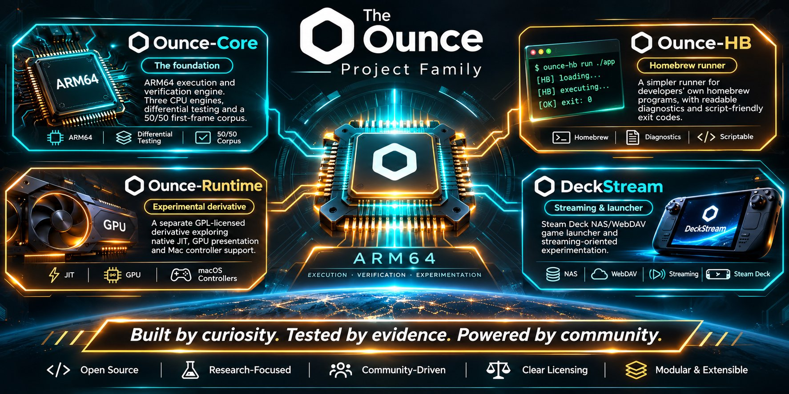

# ounce-hb

A runner for **Nintendo Switch homebrew**: unencrypted NRO (and libnx-produced NSO) programs
that you built yourself from source with [devkitPro](https://devkitpro.org/) and
[libnx](https://github.com/switchbrew/libnx).

ounce-hb runs homebrew through the released [ounce-core](https://github.com/hffgzktbcc-blip/ounce-core)
command-line tool by default, or a selected engine subprocess, and explains how each run stopped, with stable exit codes.

> **Status: v0.0.1 (Milestone M0)**. The CLI validates input formats and refuses out-of-scope
> containers. It executes validated NROs via an `ounce-core` subprocess runner in headless mode.
> See [Usage](#usage), [docs/LIMITS.md](docs/LIMITS.md), and
> [docs/OUNCE_CORE_API_NEEDS.md](docs/OUNCE_CORE_API_NEEDS.md).

## The Growing Family

<p align="center">
  
</p>

> *Built by curiosity. Tested by evidence. Powered by community.*

ounce-hb is one of four independent, open-source projects sharing an evidence-first philosophy and a community:

| Project | What it is for | When to choose it | Licence | Link |
|---|---|---|---|---|
| **ounce-core** | ARM64 execution and verification research engine. Runs programs across three CPU tiers and compares output with real hardware. | You want to check whether a program gives the same result on ARM64 as on hardware, or you want to work on the engines themselves. | MIT | [github.com/hffgzktbcc-blip/ounce-core](https://github.com/hffgzktbcc-blip/ounce-core) |
| **ounce-hb** (this repo) | Simplified homebrew runner built around Ounce-Core with diagnostics, process safety, and stable exit codes. | You want a simple way to run your own homebrew from a script or terminal and see why a run stopped. | MIT | [github.com/hffgzktbcc-blip/ounce-hb](https://github.com/hffgzktbcc-blip/ounce-hb) |
| **ounce-runtime** | Experimental performance runtime with native JIT, host GPU presentation, and controller support. | You want to experiment with high performance, visual rendering, or controller input and you accept GPL-3.0-or-later terms. | GPL-3.0-or-later | [github.com/hffgzktbcc-blip/ounce-runtime](https://github.com/hffgzktbcc-blip/ounce-runtime) |
| **deckstream** | Steam Deck NAS/WebDAV game launcher and streaming-oriented experimentation. | You want an on-demand virtual filesystem for handheld Linux gaming PCs (SteamOS) with Gaming Mode integration. | MIT | [github.com/hffgzktbcc-blip/deckstream](https://github.com/hffgzktbcc-blip/deckstream) |

**Independent siblings, clean boundaries.** Each project solves a distinct problem with its own repository, tests, and releases. DeckStream is an independent sibling, not an Ounce-Core derivative; no code flows inappropriately across licensing boundaries (`ounce-core`, `ounce-hb`, and `deckstream` are MIT; `ounce-runtime` is GPL-3.0-or-later).

---

## Scope & Non-Goals

### In Scope
- Unencrypted homebrew **NRO** files (`NRO0` magic at offset `0x10`).
- Unencrypted homebrew **NSO** files (`NSO0` magic at offset `0x00`) built from source with devkitPro/libnx (format classification supported; execution planned).
- Clean-room implementation derived solely from public specifications, libnx headers, and Arm manuals.
- Clear error reporting, diagnostic exit codes, and automated verification guardrails.

### Strictly Out of Scope (Now and Always)
- **Retail games, commercial software, and proprietary game dumps.**
- **Console keys, key derivation, or key handling** of any kind. None are accepted, stored, or processed.
- **Console firmware or system files.**
- **Encrypted retail containers**: NSP / PFS0 packages, XCI game card images, and NCA content archives.
- **Circumvention of technical protection measures** or DRM.
- **Reverse-engineered code from existing Switch emulators** (e.g., Yuzu, Ryujinx, Suyu).

Issues, pull requests, or discussions requesting retail software support, keys, firmware, or circumvention are **flagged for maintainer review and marked out of scope** (see [CONTRIBUTING.md](CONTRIBUTING.md)).

---

## Usage

### Prerequisites
1. **Rust stable toolchain** (see [rust-toolchain.toml](rust-toolchain.toml)).
2. **ounce-core CLI binary**: ounce-hb executes validated homebrew via `ounce-core run-nro <app.nro> --present=headless`.
   - Obtain a pre-built binary from the GitHub releases of [hffgzktbcc-blip/ounce-core](https://github.com/hffgzktbcc-blip/ounce-core/releases) (v0.8.0), or build from source from the [ounce-core repository](https://github.com/hffgzktbcc-blip/ounce-core).
   - Ensure `ounce-core` is available on your `PATH`, or specify its path directly via the `OUNCE_CORE_BIN` environment variable (e.g., `export OUNCE_CORE_BIN=/path/to/ounce-core`).

### Running a Homebrew Program
```sh
# Run a homebrew NRO
cargo run -- run path/to/app.nro

# Select the performance/graphical engine (still run headlessly)
cargo run -- run --backend runtime path/to/app.nro

# Or use a specific executable (options also work after the NRO path)
cargo run -- run path/to/app.nro --backend ./target/release/ounce-runtime

# Run with guest arguments (separated by --)
cargo run -- run path/to/app.nro --backend core -- arg1 arg2
```

### Backend Selection
`--backend <core|runtime|path>` overrides `OUNCE_BACKEND`; an unset or empty environment
variable defaults to `core`. Options must precede the guest `--` separator.

- `core`: use `OUNCE_CORE_BIN` when set and nonempty, otherwise find executable `ounce-core` on `PATH`.
- `runtime`: use `OUNCE_RUNTIME_BIN` when set and nonempty, otherwise find executable `ounce-runtime` on `PATH`.
- Any other value: execute that file directly, including relative paths and paths containing spaces.
  A bare filename is relative to the current directory, rather than searched on `PATH`.

A configured binary override that is missing fails with exit code 3; it does not fall back to
`PATH`. Empty `PATH` entries are skipped. Every backend must support
`run-nro <staged.nro> --present=headless [guest args...]` and the existing engine stop-line
protocol in [docs/DIAGNOSIS.md](docs/DIAGNOSIS.md). All selections share timeout killing,
bounded output capture, input validation, guest-argument restrictions, and exit classification.
Selecting runtime does not enable graphical presentation. Engine versions with different CLI
or stop-line formats are not automatically detected or retried; unrecognised stops return 1.
Dispatch tests use shell stand-ins and do not establish real-engine compatibility.

### Subprocess Runner Behavior
- **Timeout**: Each execution is subject to a 60-second wall-clock limit. If exceeded, the child process is killed and exit code 4 is returned. Set `OUNCE_HB_TIMEOUT_SECS` to a number of seconds greater than 0 and at most 86400 to change the limit; any other value is refused with exit code 2.
- **Guest Arguments**: Guest arguments starting with `-` are refused because upstream `ounce-core` silently discards them. Pass positional arguments only.
- **Headless Mode**: ounce-hb runs the selected engine with `--present=headless` so no GUI window is required. ounce-core v0.8.1 and newer also open no host audio device; v0.8.0 still tries and may print device errors where there is none.
- **Output**: Program stdout and stderr are captured while the program runs and printed when ounce-core exits (or is killed), so a long run shows nothing until it ends.
- **Stop Explanations**: When a run stops abnormally, ounce-hb prints the guest output unchanged, then a short plain-words reason, the `ounce-hb run` command that reproduces it, and the exit code. Details and the recognised ounce-core lines are in [docs/DIAGNOSIS.md](docs/DIAGNOSIS.md).

### Exit Codes
A clean guest exit returns `0`. Every other outcome has its own code, so scripts can tell categories apart. The full list is in [docs/DIAGNOSIS.md](docs/DIAGNOSIS.md).

| Exit Code | Meaning |
|---|---|
| `0` | Guest program exited normally (svcExitProcess) |
| `1` | ounce-core stopped in a way ounce-hb does not recognise (raw output is printed unchanged) |
| `2` | Bad CLI invocation, file unreadable, out-of-scope input (e.g. NSP, XCI, NCA, NPDM, or unrecognized magic), a guest argument starting with `-`, guest arguments longer than 16 KiB together ([ounce-core #418](https://github.com/hffgzktbcc-blip/ounce-core/issues/418)), a malformed `OUNCE_HB_TIMEOUT_SECS`, or an unsupported NSO kind |
| `3` | Selected backend binary missing or not found |
| `4` | Execution timeout (backend killed after 60 seconds, or `OUNCE_HB_TIMEOUT_SECS`) |
| `5` | ounce-hb could not start, wait on, or stage for the selected backend (host I/O error) |
| `10` | Unimplemented instruction in ounce-core |
| `11` | Memory access fault |
| `12` | Other CPU error reported by ounce-core |
| `13` | Guest called svcBreak |
| `14` | Guest called a system service ounce-core does not provide |
| `15` | CPU halted |
| `16` | Instruction budget exhausted before the guest exited |
| `17` | ounce-core could not load the program (loader error) |

---

## Development & Verification

Every change must pass our test suite, formatting standards, and legal guardrails:

```sh
# Check formatting
cargo fmt --all -- --check

# Run linter
cargo clippy --workspace --all-targets -- -D warnings

# Run unit and integration tests
cargo test --workspace

# Run provenance and legal guardrail checks
scripts/guardrails.sh --self-test
scripts/guardrails.sh
```

---

## Project Documentation

- **Contributing**: [CONTRIBUTING.md](CONTRIBUTING.md) — clean-room development rules, workflow, and claiming tasks.
- **Code of Conduct**: [CODE_OF_CONDUCT.md](CODE_OF_CONDUCT.md) — community standards and respectful participation.
- **Security Policy**: [SECURITY.md](SECURITY.md) — private vulnerability reporting route via GitHub Advisories.
- **Clean-Room Policy**: [docs/CLEAN_ROOM.md](docs/CLEAN_ROOM.md) — allowed sources, prohibited sources, and tainted contributor rules.
- **Project Vision**: [docs/VISION.md](docs/VISION.md) — purpose, pillars, and milestone roadmap.
- **Honest Limits**: [docs/LIMITS.md](docs/LIMITS.md) — verified current capabilities and explicit permanent limits.
- **Add a Program**: [docs/ADD_A_PROGRAM.md](docs/ADD_A_PROGRAM.md) — building and testing a homebrew binary with devkitPro.
- **Upstream Core Needs**: [docs/OUNCE_CORE_API_NEEDS.md](docs/OUNCE_CORE_API_NEEDS.md) — library API requirements for future in-process ounce-core integration.
- **Provenance Register**: [docs/PROVENANCE.md](docs/PROVENANCE.md) — tracking of all binary fixtures and their toolchains.
- **Wiki**: [docs/wiki/Home.md](docs/wiki/Home.md) — repository wiki pages (Home, Getting started, FAQ, Clean-room policy, Architecture, Roadmap).
- **Credits**: [CREDITS.md](CREDITS.md) — contributors, upstream projects, and toolchains.
- **Changelog**: [CHANGELOG.md](CHANGELOG.md) — version history and milestone tracking.

---

## Legal & Disclaimers

ounce-hb is an independent open-source project and is not affiliated with, endorsed by, or sponsored by Nintendo. "Nintendo" and "Nintendo Switch" are registered trademarks of Nintendo of America Inc. and Nintendo Co., Ltd. These terms are used strictly for compatibility identification and descriptive purposes.

This project is licensed under the [MIT License](LICENSE).
